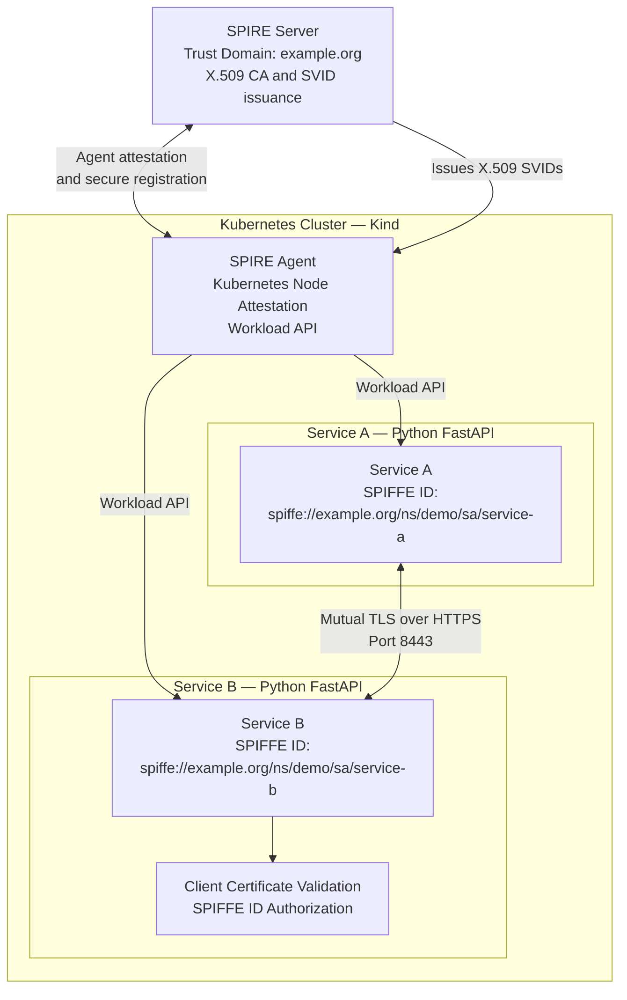

# SPIRE Workload Identity & mTLS Proof of Concept

A hands-on implementation of **Zero Trust workload identity and mutual TLS (mTLS)** using SPIFFE, SPIRE, Kubernetes, and Python.

This project demonstrates how workloads running in Kubernetes can obtain cryptographically verifiable identities without relying on static application credentials, establish mutually authenticated connections, and enforce identity-based authorization.

## Overview

Traditional service-to-service authentication often relies on static API keys, shared secrets, or long-lived certificates.

This proof of concept explores a different approach:

- SPIRE attests workloads running in Kubernetes.
- SPIRE issues short-lived X.509 SVIDs (SPIFFE Verifiable Identity Documents).
- Applications retrieve workload identity through the SPIFFE Workload API.
- Services authenticate each other using mutual TLS.
- Authorization decisions are based on verified SPIFFE identities.

The implementation includes two Python services:

- **Service A:** Acts as an mTLS client.
- **Service B:** Acts as an mTLS server and enforces client identity authorization.

## Architecture

The implementation runs on a local Kubernetes cluster using Kind.



**Important:** The current local implementation uses one SPIRE Agent on the Kind node. Both workloads obtain their identities through that Agent.

## Technology Stack

| Component | Technology |
|---|---|
| Workload identity | SPIFFE |
| Identity infrastructure | SPIRE 1.11.2 |
| Orchestration | Kubernetes |
| Local cluster | Kind |
| Application services | Python, FastAPI |
| Authentication | X.509 SVID |
| Transport security | Mutual TLS |
| TLS implementation | Python `ssl` |
| SPIFFE SDK | py-spiffe 0.4.0 |
| Container runtime | Docker |

## Implementation Details

### 1. SPIRE Server

The SPIRE Server acts as the trust authority for the `example.org` trust domain.

Responsibilities:

- Maintains the trust domain.
- Performs node attestation.
- Registers workloads and their selectors.
- Issues X.509 SVIDs.
- Publishes the trust bundle used for certificate validation.

### 2. SPIRE Agent

The SPIRE Agent runs as a Kubernetes DaemonSet.

It uses:

- Kubernetes PSAT node attestation.
- Kubernetes workload attestation.
- Kubernetes namespace and service account selectors.
- SPIFFE Workload API over a Unix domain socket.

The Agent identifies workloads based on their Kubernetes attributes rather than trusting application-provided identity claims.

### 3. Workload Identity

The following workload identities are registered:

**Service A**

`spiffe://example.org/ns/demo/sa/service-a`

**Service B**

`spiffe://example.org/ns/demo/sa/service-b`

Each workload retrieves its X.509 SVID and associated trust bundle through the SPIFFE Workload API.

### 4. Mutual TLS

Service A initiates a connection to Service B over port `8443`.

The connection performs:

1. Service A presents its X.509 SVID.
2. Service B presents its X.509 SVID.
3. Both sides validate the certificate chain against the SPIRE trust bundle.
4. Service A verifies Service B's SPIFFE URI SAN.
5. Service B verifies the client's SPIFFE identity.
6. Service B evaluates whether the authenticated identity is authorized.

The implementation uses TLS 1.2 or higher.

### 5. Identity-Based Authorization

Service B explicitly allows Service A's SPIFFE identity:

`spiffe://example.org/ns/demo/sa/service-a`

A valid certificate alone is not sufficient for access.

The application checks the authenticated SPIFFE identity and returns HTTP 403 when the identity is not authorized.

The current implementation uses a hardcoded identity check. A future iteration will replace this with policy-driven authorization using Cedar.

## Security Validation

The following tests were executed successfully in the local Kubernetes environment.

| Test | Expected result | Actual result |
|---|---|---|
| Service A retrieves SVID | Identity issued | Passed |
| Service B retrieves SVID | Identity issued | Passed |
| Service A connects to Service B | HTTP 200 | Passed |
| Service B validates Service A | Authorized | Passed |
| Service B connects using its own identity | HTTP 403 | Passed |
| Invalid client identity | Denied | Application-level authorization enforced |

### Successful authorization

Service A authenticated to Service B using its X.509 SVID.

Example response:

```json
{
  "service": "service-b",
  "authenticated_client": "spiffe://example.org/ns/demo/sa/service-a",
  "authorization": "allowed",
  "transport": "mutual-tls"
}
```

### Negative authorization test

A connection using Service B's own identity was rejected when attempting to access the protected endpoint.

Result:

```text
HTTP/1.0 403 Unauthorized SPIFFE identity
```

This demonstrates the distinction between **authentication** (proving workload identity) and **authorization** (determining whether that identity may access a resource).

## Repository Structure

```text
spire-workload-identity-mtls-poc/
│
├── README.md
├── .gitignore
│
├── spire/
│   ├── server/
│   │   ├── server-account.yaml
│   │   ├── server-cluster-role.yaml
│   │   ├── server-configmap.yaml
│   │   ├── server-service.yaml
│   │   ├── server-statefulset.yaml
│   │   ├── spire-bundle-configmap.yaml
│   │   └── spire-namespace.yaml
│   │
│   ├── agent/
│   │   ├── agent-account.yaml
│   │   ├── agent-cluster-role.yaml
│   │   ├── agent-configmap.yaml
│   │   └── agent-daemonset.yaml
│   │
│   └── registration/
│       └── create-node-registration-entry.sh
│
├── k8s/
│   ├── service-a.yaml
│   └── service-b.yaml
│
└── services/
    ├── service-a/
    │   ├── app.py
    │   ├── mtls_client.py
    │   ├── tls_utils.py
    │   ├── requirements.txt
    │   └── Dockerfile
    │
    └── service-b/
        ├── app.py
        ├── mtls_server.py
        ├── tls_utils.py
        ├── requirements.txt
        └── Dockerfile
```

## Running the Proof of Concept

### Prerequisites

- Docker Desktop
- Kind
- kubectl
- A local machine capable of running Docker containers and Kubernetes workloads

### 1. Create the Kubernetes cluster

```bash
kind create cluster --name spire-lab
```

### 2. Deploy SPIRE Server

```bash
kubectl apply -f spire/server/spire-namespace.yaml
kubectl apply -f spire/server/
```

Wait for the Server:

```bash
kubectl get pods -n spire
```

### 3. Deploy SPIRE Agent

```bash
kubectl apply -f spire/agent/
```

Verify the Agent:

```bash
kubectl get pods -n spire
```

### 4. Register the node

```bash
chmod +x spire/registration/create-node-registration-entry.sh

./spire/registration/create-node-registration-entry.sh
```

### 5. Register the workloads

Create the demo namespace and service accounts:

```bash
kubectl create namespace demo

kubectl create serviceaccount service-a -n demo
kubectl create serviceaccount service-b -n demo
```

Register Service A:

```bash
kubectl exec -n spire spire-server-0 -- \
  /opt/spire/bin/spire-server entry create \
  -parentID spiffe://example.org/ns/spire/sa/spire-agent \
  -spiffeID spiffe://example.org/ns/demo/sa/service-a \
  -selector k8s:ns:demo \
  -selector k8s:sa:service-a
```

Register Service B:

```bash
kubectl exec -n spire spire-server-0 -- \
  /opt/spire/bin/spire-server entry create \
  -parentID spiffe://example.org/ns/spire/sa/spire-agent \
  -spiffeID spiffe://example.org/ns/demo/sa/service-b \
  -selector k8s:ns:demo \
  -selector k8s:sa:service-b
```

### 6. Build the application images

From the project root:

```bash
docker build --platform linux/amd64 \
  -t spire-service-a:dev services/service-a

docker build --platform linux/amd64 \
  -t spire-service-b:dev services/service-b
```

Load the images into Kind:

```bash
kind load docker-image spire-service-a:dev --name spire-lab

kind load docker-image spire-service-b:dev --name spire-lab
```

### 7. Deploy the services

```bash
kubectl apply -f k8s/service-a.yaml
kubectl apply -f k8s/service-b.yaml
```

Verify:

```bash
kubectl get pods -n demo
kubectl get services -n demo
```

### 8. Test workload identity

```bash
kubectl exec -n demo deployment/service-a -- python -c \
"from spiffe import X509Source; s=X509Source(); print(s.svid.spiffe_id); s.close()"
```

### 9. Test mutual TLS

Run the mTLS client from Service A:

```bash
kubectl exec -n demo deployment/service-a -- \
  python mtls_client.py
```

Expected result: HTTP 200 with the authenticated Service A SPIFFE identity.

## Security Considerations and Current Limitations

This is a local proof of concept, not a production-ready deployment.

The following improvements are identified:

| Area | Current implementation | Future improvement |
|---|---|---|
| Authorization | Hardcoded SPIFFE identity | Cedar policy engine |
| SVID lifecycle | Startup snapshot | Automatic SVID rotation |
| TLS credentials | Temporary files with restricted permissions | In-memory, rotation-aware TLS credentials |
| Trust bundle | Startup snapshot | Dynamic bundle updates |
| Auditability | Basic HTTP responses | Structured identity and authorization audit events |
| Deployment | Local Kind cluster | Production-grade Kubernetes deployment |
| Policy lifecycle | Static authorization logic | Versioned policies and staged rollout |

The current Python TLS implementation writes the private key to a temporary file with restrictive permissions (`0600`). This is a POC implementation detail and should be replaced with an in-memory, rotation-aware credential integration for production.

The SPIRE Agent requires elevated node-level access for workload attestation. Its privileges and host mounts must be carefully constrained in production.

## Future Engineering Work

Potential extensions include:

- Cedar-based fine-grained authorization.
- Dynamic SVID and trust bundle rotation.
- Policy decision and enforcement separation (PDP/PEP).
- Workload identity federation across Kubernetes clusters.
- Identity-aware authorization for AI agents and MCP tool calls.
- Short-lived, delegated workload credentials.
- Policy change impact analysis and staged rollout.
- Structured audit trails and identity attribution.

## Design Principles

This project explores several important Zero Trust principles:

1. **Identity over network location:** Workload identity is independent of IP address.
2. **Cryptographic authentication:** Services authenticate using X.509 SVIDs.
3. **Least privilege:** Authenticated workloads are not automatically authorized.
4. **Short-lived credentials:** Workload identity is issued and managed by SPIRE rather than embedded as static application secrets.
5. **Explicit authorization:** Access is granted based on verified identity.

## References

- [SPIFFE Documentation](https://spiffe.io/docs/latest/)
- [SPIRE Documentation](https://spiffe.io/docs/latest/spire-about/)
- [SPIRE GitHub Repository](https://github.com/spiffe/spire)
- [SPIFFE Workload API](https://github.com/spiffe/spiffe/blob/main/standards/SPIFFE_Workload_API.md)
- [py-spiffe](https://github.com/spiffe/py-spiffe)
- [Cedar Policy Language](https://www.cedarpolicy.com/)

SPIRE deployment patterns in this project were informed by the official SPIRE Kubernetes quickstart tutorials.

## Disclaimer

This repository is an independent technical proof of concept intended for educational, research, and architectural demonstration purposes. It is not a production security deployment.
